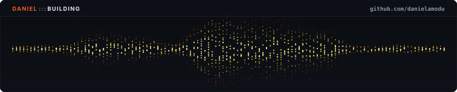
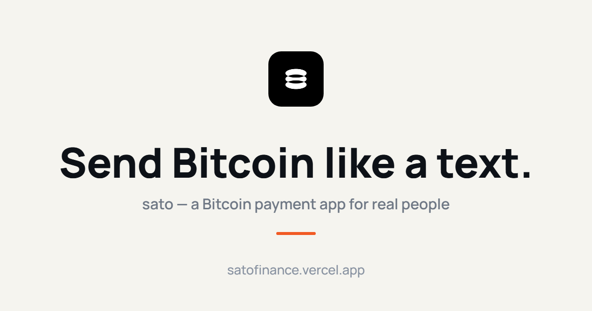

  

<table width="100%">
  <tr>
    <td width="62%" valign="top">
      <h1>daniel</h1>
      
<b>Software engineer & product builder building on Bitcoin, distributed systems, and agentic workflows.</b>

      

        <code>NOW   </code> &nbsp; building <b><a href="https://satoxbt.com">sato</a></b> · non-custodial Bitcoin micropayments & gasless rails 
        <code>HANDLE</code> &nbsp; <b>@danielamodu</b> · <b><a href="https://x.com/fortyxbt">@fortyxbt</a></b> 
        <code>ORIGIN</code> &nbsp; Lagos, Nigeria · Landmark CS '26
      

    </td>
    <td width="38%" valign="top">
      <table width="100%">
        <tr>
          <td>FOCUS <b>Bitcoin · AI · Cloud</b></td>
          <td>ROLE <b>Engineer & Builder</b></td>
        </tr>
        <tr>
          <td>STATUS <b>Shipping</b></td>
          <td>STACK <b>TS · Clarity · Python · Rust</b></td>
        </tr>
      </table>
    </td>
  </tr>
</table>

 

### ⚡ Featured Projects

<table>
  <tr>
    <!-- SATO CARD -->
    <td width="50%" valign="top">
      

        
<b>1 &nbsp; sato</b> &nbsp; <code>satoxbt.com</code>

        
          
        <b><a href="https://satoxbt.com">Sato</a></b> · BITCOIN / FINTECH
        
Non-custodial Bitcoin wallet, sBTC yield-v3 engine, Nigerian utility bill settlement (VTPass), and gasless meta-transaction co-signing.

        <table>
          <tr>
            <td>STACK <b>Stacks · Clarity · TypeScript</b></td>
            <td>DOCS <b><a href="https://docs.satoxbt.com">docs.satoxbt.com ↗</a></b></td>
            <td>STATUS <b>Testnet Live</b></td>
          </tr>
        </table>
         
        <a href="https://satoxbt.com"><code> VISIT SATO ↗ </code></a> &nbsp;
        <a href="https://docs.satoxbt.com"><code> INTERACTIVE DOCS ↗ </code></a>
      

    </td>

    <!-- VENDORINTEL & HERMES CARD -->
    <td width="50%" valign="top">
      

        
<b>2 &nbsp; hermes & vendorintel</b> &nbsp; <code>ai & distributed systems</code>

         
        <b><a href="https://hermesxbt.vercel.app">Hermes</a></b> · ONCHAIN AGENT PARSER
        
Natural-language onchain execution interface. Translates intent into verified transactions with prompt response validation.

         
        <b><a href="https://github.com/danielamodu">VendorIntel</a></b> · CLOUD INTELLIGENCE
        
Event-driven market intelligence platform. SQS-buffered scraping workers, VADER NLP sentiment on DynamoDB streams, and Terraform infrastructure.

        <table>
          <tr>
            <td>CLOUD <b>AWS (SQS, Lambda, DynamoDB)</b></td>
            <td>NLP <b>VADER · RAG</b></td>
            <td>IAC <b>Terraform</b></td>
          </tr>
        </table>
         
        <a href="https://hermesxbt.vercel.app"><code> VISIT HERMES ↗ </code></a> &nbsp;
        <a href="https://github.com/danielamodu"><code> VIEW GITHUB ↗ </code></a>
      

    </td>
  </tr>
</table>

 

### 📂 Registry

| Project | Description | Stack | Status |
| :--- | :--- | :--- | :--- |
| **[sato](https://satoxbt.com)** | Non-custodial Bitcoin wallet with sponsored gasless transfers & SIP-010 vault | `TypeScript` `Clarity` `Stacks` | **[Live ↗](https://satoxbt.com)** |
| **[sato-docs](https://docs.satoxbt.com)** | Interactive component playground & protocol documentation | `React` `Tailwind` `Vite` | **[Docs ↗](https://docs.satoxbt.com)** |
| **[vendorintel](https://github.com/danielamodu)** | Cloud-native market intelligence pipeline with AWS & VADER NLP | `Python` `AWS` `Terraform` | **Shipped** |
| **[hermes](https://hermesxbt.vercel.app)** | Natural-language onchain transaction execution engine | `TypeScript` `Next.js` `APIs` | **[Beta ↗](https://hermesxbt.vercel.app)** |
| **[med-scribe](https://github.com/danielamodu/med-scribe)** | Offline clinical RAG tool for local patient-history retrieval | `Python` `Local LLM` `RAG` | **[Repo ↗](https://github.com/danielamodu/med-scribe)** |
| **[vela](https://velaxbt.vercel.app)** | Verifiable AI dataset provenance & data quality review registry | `Next.js` `Python` `NLP` | **[Live ↗](https://velaxbt.vercel.app)** |
| **[covert](https://covertxbt.vercel.app)** | Autonomous agent commerce, prediction market, and payment rails | `Solidity` `Next.js` `Web3` | **[Live ↗](https://covertxbt.vercel.app)** |

 

---

  <a href="https://satoxbt.com"><code> 🌐 satoxbt.com ↗ </code></a> &nbsp;&nbsp;
  <a href="https://docs.satoxbt.com"><code> 📖 docs.satoxbt.com ↗ </code></a> &nbsp;&nbsp;
  <a href="https://x.com/fortyxbt"><code> 𝕏 @fortyxbt ↗ </code></a> &nbsp;&nbsp;
  <a href="https://linkedin.com/in/danielamodu"><code> 💼 in/danielamodu ↗ </code></a> &nbsp;&nbsp;
  <a href="mailto:theamebonetwork@gmail.com"><code> ✉️ contact ↗ </code></a>

