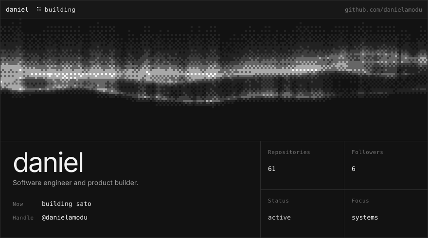
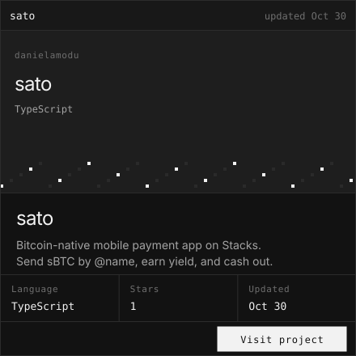
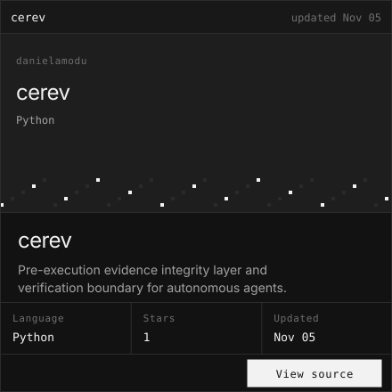
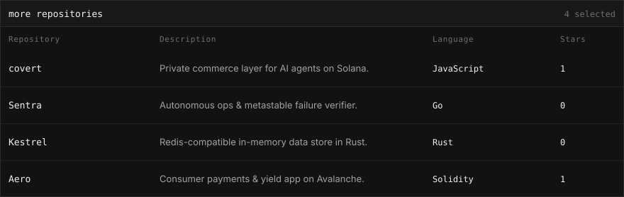
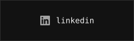
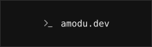
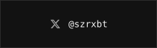
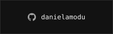

<!-- Generated by scripts/build-profile.mjs. Edit profile.config.json, not this file. -->

<picture><source media="(prefers-color-scheme: dark)" srcset="./profile/generated/header-91f42a8971-dark.svg"><source media="(prefers-color-scheme: light)" srcset="./profile/generated/header-91f42a8971-light.svg"></picture>

<a href="https://satoxbt.com"><picture><source media="(prefers-color-scheme: dark)" srcset="./profile/generated/project-01-91f42a8971-dark.svg"><source media="(prefers-color-scheme: light)" srcset="./profile/generated/project-01-91f42a8971-light.svg"></picture></a><a href="https://github.com/danielamodu/cerev"><picture><source media="(prefers-color-scheme: dark)" srcset="./profile/generated/project-02-91f42a8971-dark.svg"><source media="(prefers-color-scheme: light)" srcset="./profile/generated/project-02-91f42a8971-light.svg"></picture></a>

<a href="https://github.com/danielamodu?tab=repositories"><picture><source media="(prefers-color-scheme: dark)" srcset="./profile/generated/repos-91f42a8971-dark.svg"><source media="(prefers-color-scheme: light)" srcset="./profile/generated/repos-91f42a8971-light.svg"></picture></a>

<a href="https://www.linkedin.com/in/daniel-amodu-szr"><picture><source media="(prefers-color-scheme: dark)" srcset="./profile/generated/link-01-91f42a8971-dark.svg"><source media="(prefers-color-scheme: light)" srcset="./profile/generated/link-01-91f42a8971-light.svg"></picture></a><a href="https://amodu.dev"><picture><source media="(prefers-color-scheme: dark)" srcset="./profile/generated/link-02-91f42a8971-dark.svg"><source media="(prefers-color-scheme: light)" srcset="./profile/generated/link-02-91f42a8971-light.svg"></picture></a><a href="https://x.com/szrxbt"><picture><source media="(prefers-color-scheme: dark)" srcset="./profile/generated/link-03-91f42a8971-dark.svg"><source media="(prefers-color-scheme: light)" srcset="./profile/generated/link-03-91f42a8971-light.svg"></picture></a><a href="https://github.com/danielamodu"><picture><source media="(prefers-color-scheme: dark)" srcset="./profile/generated/link-04-91f42a8971-dark.svg"><source media="(prefers-color-scheme: light)" srcset="./profile/generated/link-04-91f42a8971-light.svg"></picture></a>

